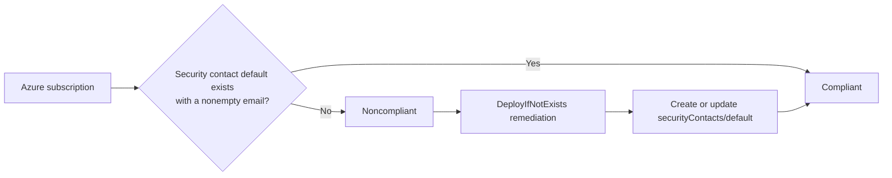

# Automatically Configure Microsoft Defender for Cloud Security Contacts with Azure Policy

Security alerts are useful only when they reach the right people. In a large Azure environment, manually configuring a Microsoft Defender for Cloud security contact in every subscription is slow, inconsistent, and easy to overlook.

This article presents a custom Azure Policy definition that detects subscriptions without a security contact email address and deploys the required configuration automatically.

> This policy targets Azure Commercial (`AzureCloud`). It is not intended for Azure Government or Azure China without additional testing and modification.

## The Challenge

Microsoft Defender for Cloud uses the subscription security contact to notify your organization about security alerts. Without consistent configuration:

- New subscriptions can be created without a security contact.
- Alert recipients can vary between subscriptions.
- Security teams must repeatedly audit and repair configuration manually.
- An audit-only policy identifies the gap but does not correct it.
- Important alerts may not reach the responsible team promptly.

The Microsoft built-in policy **Subscriptions should have a contact email address for security issues** uses `AuditIfNotExists`. It reports missing configuration but does not deploy it. This custom policy adds remediation through `DeployIfNotExists`.

## What the Policy Does

The policy evaluates every subscription in its assignment scope. It looks for the singleton resource:

```text
Microsoft.Security/securityContacts/default
```

A subscription is compliant when the `Microsoft.Security/securityContacts/emails` property is not empty. If the resource or email address is missing, the policy deploys a security contact with:

- The email address supplied during policy assignment.
- Security alert notifications enabled or disabled through a parameter.
- Optional notifications to users with the subscription `Owner` role.
- Alert notifications for `High` severity and above.
- The current Azure Commercial resource shape from API version `2023-12-01-preview`.

The policy can also be disabled using its `effect` parameter.

## Why a Custom Policy Was Created

The original built-in policy solves detection, not remediation. A custom definition was needed to:

1. Standardize the contact address across subscriptions.
2. Automatically configure new or existing noncompliant subscriptions.
3. Reduce manual governance work.
4. Support remediation tasks for resources that existed before assignment.
5. Use the modern Azure Commercial security contact properties, including `emails`, `isEnabled`, `notificationsByRole`, and `notificationsSources`.

## How It Works



The policy uses these important settings:

| Setting | Purpose |
|---|---|
| `mode: All` | Evaluates the subscription resource type. |
| `existenceScope: Subscription` | Searches for the contact at subscription scope. |
| `deploymentScope: Subscription` | Runs the remediation template at subscription scope. |
| `name: default` | Targets the singleton Defender for Cloud security contact. |
| `location: eastus` | Stores subscription-level ARM deployment metadata. The contact itself is not regional. |
| `Security Admin` role | Allows the assignment identity to manage the security contact. |

## Policy Parameters

| Parameter | Required | Default | Description |
|---|---:|---|---|
| `effect` | No | `DeployIfNotExists` | Deploys missing configuration or disables the policy. |
| `emailAddress` | Yes | None | Email address that receives Defender for Cloud alerts. |
| `alertNotifications` | No | `On` | Controls whether the security contact is enabled. |
| `alertsToAdmins` | No | `On` | Controls notifications to subscription Owners. |

## Files

| File | Purpose |
|---|---|
| `ASC_Security_contact_email_DeployIfNotExists.json` | Complete custom policy definition and source of truth. |
| `ASC_Security_contact_email.json` | Original audit-only built-in definition retained for comparison. |
| `policyRule.json` | Azure CLI policy rule extracted from the custom definition. |
| `policyParameters.json` | Azure CLI parameter schema extracted from the custom definition. |
| `LICENSE` | MIT license and warranty disclaimer. |

## Prerequisites

You need:

- Azure CLI installed.
- Permission to create policy definitions and assignments at the target scope.
- Permission to create role assignments, such as `Owner` or `User Access Administrator` plus suitable Policy permissions.
- A target Azure Commercial subscription.
- PowerShell 7 or Windows PowerShell.

The examples below run from the folder containing the policy files.

## Deploy the Policy

### 1. Connect to Azure Commercial

```powershell
az cloud set --name AzureCloud
az login

$subscriptionId = az account show --query id -o tsv
az account set --subscription $subscriptionId
$scope = "/subscriptions/$subscriptionId"
```

Confirm the active cloud and subscription:

```powershell
az cloud show --query name -o tsv
az account show --query "{subscription:name, id:id, tenantId:tenantId}" -o table
```

The cloud command should return `AzureCloud`.

### 2. Extract the CLI Artifacts

`az policy definition create` expects the policy rule and parameter schema separately rather than the complete policy envelope.

```powershell
$policyFile = ".\ASC_Security_contact_email_DeployIfNotExists.json"
$policy = Get-Content $policyFile -Raw | ConvertFrom-Json -Depth 100

$policy.properties.policyRule |
    ConvertTo-Json -Depth 100 |
    Set-Content .\policyRule.json -Encoding utf8

$policy.properties.parameters |
    ConvertTo-Json -Depth 100 |
    Set-Content .\policyParameters.json -Encoding utf8
```

### 3. Create the Custom Definition

```powershell
$definitionName = "deploy-security-contact-email"

az policy definition create `
    --name $definitionName `
    --display-name $policy.properties.displayName `
    --description $policy.properties.description `
    --mode All `
    --rules .\policyRule.json `
    --params .\policyParameters.json `
    --metadata "category='Security Center'" "version='2.0.0'" `
    --subscription $subscriptionId
```

The inner quotes around `Security Center` are required because Azure CLI shorthand values containing spaces must be quoted.

Confirm the definition:

```powershell
$definitionId = az policy definition show `
    --name $definitionName `
    --subscription $subscriptionId `
    --query id -o tsv

$definitionId
```

### 4. Create Assignment Parameters

Replace the example address before running this command:

```powershell
@{
    emailAddress       = @{ value = "security@contoso.com" }
    alertNotifications = @{ value = "On" }
    alertsToAdmins     = @{ value = "On" }
} | ConvertTo-Json -Depth 10 |
    Set-Content .\assignmentParameters.json -Encoding utf8
```

Do not add a `deploymentLocation` assignment parameter. The required subscription-deployment metadata location is defined as `eastus` inside the policy rule.

### 5. Assign the Policy with a Managed Identity

`DeployIfNotExists` requires a managed identity. The command also grants the declared `Security Admin` role at subscription scope.

```powershell
$assignmentName = "deploy-security-contact-email"

az policy assignment create `
    --name $assignmentName `
    --display-name "Deploy Defender for Cloud security contact" `
    --scope $scope `
    --policy $definitionId `
    --params .\assignmentParameters.json `
    --location eastus `
    --mi-system-assigned `
    --identity-scope $scope `
    --role "Security Admin"
```

The assignment `--location` stores the system-assigned identity metadata. It does not make the security contact regional.

Confirm the identity and role assignment:

```powershell
$assignment = az policy assignment show `
    --name $assignmentName `
    --scope $scope | ConvertFrom-Json

$assignment.identity

az role assignment list `
    --assignee-object-id $assignment.identity.principalId `
    --scope $scope `
    --query "[].{role:roleDefinitionName, scope:scope}" -o table
```

## Remediate Existing Subscriptions

Policy assignment does not immediately modify existing resources. Create a remediation task and request fresh resource discovery:

```powershell
$assignmentId = az policy assignment show `
    --name $assignmentName `
    --scope $scope `
    --query id -o tsv

az policy remediation create `
    --name "remediate-security-contact" `
    --scope $scope `
    --policy-assignment $assignmentId `
    --resource-discovery-mode ReEvaluateCompliance
```

Monitor remediation:

```powershell
az policy remediation show `
    --name "remediate-security-contact" `
    --scope $scope `
    --query "{state:provisioningState, deployments:deploymentStatus}" -o json
```

Policy evaluation and remediation are asynchronous and can take several minutes.

## Validate the Deployment

### Check the Security Contact

```powershell
az rest --method get `
    --url "/subscriptions/$subscriptionId/providers/Microsoft.Security/securityContacts/default?api-version=2023-12-01-preview" `
    --query "{name:name, emails:properties.emails, enabled:properties.isEnabled, roles:properties.notificationsByRole, sources:properties.notificationsSources}" `
    -o json
```

Expected results include:

- Resource name `default`.
- The assigned email address in `properties.emails`.
- `properties.isEnabled` set according to `alertNotifications`.
- `Owner` in `properties.notificationsByRole.roles` when admin alerts are enabled.
- An `Alert` notification source with `High` minimum severity.

### Check Policy Compliance

Trigger an on-demand evaluation:

```powershell
az policy state trigger-scan --subscription $subscriptionId --no-wait
```

After evaluation completes, inspect the assignment state:

```powershell
az policy state list `
    --resource $scope `
    --filter "PolicyAssignmentId eq '$assignmentId'" `
    --query "[].{state:complianceState, resourceId:resourceId, timestamp:timestamp}" `
    -o table
```

You can also use **Azure portal > Policy > Compliance**, open the assignment, and review its resource compliance and remediation details.

## Test the Noncompliant Path

Use a nonproduction subscription for this test.

1. Assign the policy with a known test email address.
2. Delete or clear the existing security contact configuration.
3. Trigger a policy scan.
4. Confirm that the subscription becomes noncompliant.
5. Start a remediation task.
6. Verify that `securityContacts/default` is recreated and the subscription becomes compliant after reevaluation.

Deleting a security contact affects Defender for Cloud notification delivery. Do not perform this test in production without an approved change plan.

## Troubleshooting

### Metadata shorthand parsing fails

Use separate, quoted metadata expressions:

```powershell
--metadata "category='Security Center'" "version='2.0.0'"
```

### Azure reports an unused `deploymentLocation` parameter

Do not parameterize `details.deployment.location`. Expressions under the DINE `deployment` object are evaluated as ARM template expressions, except for the explicit policy-to-template parameter bridge. This policy therefore uses the literal Commercial region `eastus` for subscription deployment metadata.

Regenerate `policyRule.json` and `policyParameters.json` from the complete policy after changing it.

### Remediation does not start

Verify that:

- The assignment has a system-assigned managed identity.
- The identity has `Security Admin` at the subscription scope.
- The assignment scope is the subscription or a parent management group.
- The `Microsoft.Security` resource provider is registered.

```powershell
az provider show --namespace Microsoft.Security --query registrationState -o tsv
```

### The subscription remains noncompliant

Policy state can lag behind deployment. Confirm the contact using `az rest`, trigger another scan, and wait for the next compliance result. Also inspect failed deployments:

```powershell
az deployment sub list `
    --query "[?properties.provisioningState=='Failed'].{name:name, timestamp:properties.timestamp, error:properties.error}" `
    -o json
```

## Deploying at Management Group Scope

The definition can be created and assigned at management group scope to govern multiple subscriptions. Use `--management-group` when creating the definition and a management-group resource ID as the assignment scope. Ensure the assignment identity receives the required role on every target subscription. Role propagation and remediation across subscriptions should be tested carefully before broad rollout.

## Remove the Deployment

```powershell
az policy remediation delete `
    --name "remediate-security-contact" `
    --scope $scope

az policy assignment delete `
    --name $assignmentName `
    --scope $scope

az policy definition delete `
    --name $definitionName `
    --subscription $subscriptionId
```

Deleting the policy assignment or definition does not delete the deployed security contact.

## Security and Operational Considerations

- Use a monitored distribution list rather than an individual mailbox.
- Test notification routing and ownership processes separately from policy compliance.
- Start with a nonproduction subscription before assigning at scale.
- Treat policy updates as code changes and review them before deployment.
- Use the least privileged role that supports the required Microsoft Security operations. This implementation declares the built-in `Security Admin` role.
- API version `2023-12-01-preview` is a preview API and should be reevaluated when a stable API supporting the same resource shape becomes available.

Microsoft lists `Microsoft.Security/securityContacts` as having a nonstandard creation pattern. Policy behavior for this resource type can therefore be incomplete in some enforcement scenarios. This implementation uses `DeployIfNotExists` with a named related resource and an existence condition, but it should still be validated in every target tenant and monitored after Azure API or alias changes.

## Attribution

This work is adapted from the Microsoft Azure Policy built-in definition **Subscriptions should have a contact email address for security issues** and the [Azure Policy repository](https://github.com/Azure/azure-policy). The upstream repository is licensed under the MIT License and carries the Microsoft Corporation copyright notice preserved in this project's `LICENSE` file.

## References

- [DeployIfNotExists policy effect](https://learn.microsoft.com/azure/governance/policy/concepts/effect-deploy-if-not-exists)
- [Remediate noncompliant resources](https://learn.microsoft.com/azure/governance/policy/how-to/remediate-resources)
- [Microsoft.Security securityContacts resource](https://learn.microsoft.com/azure/templates/microsoft.security/2023-12-01-preview/securitycontacts)
- [Azure Policy definition structure](https://learn.microsoft.com/azure/governance/policy/concepts/definition-structure-basics)
- [Azure Policy repository](https://github.com/Azure/azure-policy)

## License and Disclaimer

This project is distributed under the [MIT License](LICENSE). It is provided **as is**, without warranty of any kind. Validate the policy in your own environment before production use.
